 

 

<table align="center">
<tr>
<td align="center" width="25%"><h2>1.8M+</h2>records processed with PySpark</td>
<td align="center" width="25%"><h2>20K+</h2>events per day in streaming ETL</td>
<td align="center" width="25%"><h2>92%</h2>CNN accuracy with ResNet50</td>
<td align="center" width="25%"><h2>2×</h2>Databricks Associate certifications</td>
</tr>
</table>

---

## About

I'm a Data Scientist with a **First Class Honours degree in Computer Science** and two **Databricks certifications** (Machine Learning and Generative AI), currently working in industry. I build end-to-end AI systems — from scalable PySpark pipelines and cloud data lakes to predictive models and LLM-powered RAG applications.

My work spans machine learning (XGBoost, Random Forest, CNNs), generative AI with retrieval-augmented generation, and event-driven ETL on AWS and Databricks lakehouse architectures — always with an eye on **explainability, testing and production-ready reliability**.

---

## Expertise

<table>
<tr>
<td valign="top" width="50%">

#### Machine Learning & Data Science
Predictive models from feature engineering to evaluation — gradient boosting, ensembles, CNNs and transfer learning, with SHAP/LIME explainability.

</td>
<td valign="top" width="50%">

#### Generative AI & RAG
LLM applications grounded in your data — embeddings, vector search and retrieval pipelines that give accurate, contextual answers.

</td>
</tr>
<tr>
<td valign="top" width="50%">

#### Data Engineering & Databricks
Scalable ETL/ELT and event-driven pipelines on lakehouse architecture — Spark processing, Delta Lake, Parquet and cloud data lakes.

</td>
<td valign="top" width="50%">

#### Analytics & BI
Forecasting, clustering and dashboards that turn data into decisions — and cut manual reporting along the way.

</td>
</tr>
</table>

Also experienced in full-stack engineering for shipping ML to users — React, Django, FastAPI, Node.js, Docker and CI/CD with GitHub Actions.

---

## Featured Projects

### [CureLens AI](https://github.com/Saabithsp/CureLens-AI) &nbsp;ML · RAG · Explainable AI

A personalised medication-risk platform. Multi-model ML (XGBoost, Random Forest, cosine similarity) predicts drug-interaction risk, and a RAG chatbot combines structured drug data with LLM reasoning, with SHAP/LIME explaining each prediction.

- Processed **1.8M+ DrugBank records** with PySpark, cutting preprocessing time by **60%**

    

### Sales Forecasting Pipeline &nbsp;Data Engineering · Forecasting

An event-driven lakehouse-style pipeline: RabbitMQ ingestion with dead-letter queues, PySpark ELT to Parquet on S3, Glue and Athena for querying, forecasting models and Power BI dashboards.

- Handles **20K+ events per day**, with **30% lower storage** using Parquet and **25% better forecast accuracy**

   

### Face Mask Detection &nbsp;Deep Learning · Computer Vision

A CNN image classifier using ResNet50 transfer learning, with an augmentation pipeline and hyperparameter tuning.

- Reached **92% accuracy**; augmentation reduced overfitting by **~20%** and tuning lifted F1 by **~10%**

  

<b>Also built — web, mobile and systems projects</b>

 

| Project | Description | Stack |
| :--- | :--- | :--- |
| **PN Fernando Seafood Palace** | Full-stack reservations and inventory system with RBAC, CI/CD and Docker | React · Node.js · Docker |
| [**AP.lk Payment Interface**](https://appayment-xi.vercel.app) | Clean, secure online checkout flow — [live demo](https://appayment-xi.vercel.app) | MERN |
| [**HPC Password Cracker**](https://github.com/Saabithsp/HPC-Portfolio-Password-Cracker) | Parallel password cracking with PThreads and CUDA, plus GPU matrix multiplication and image blur | C++ · CUDA |
| [**Ceylon Taste**](https://github.com/Saabithsp/Ceylon-Taste-Web-Application) | Dynamic site showcasing traditional Sri Lankan cuisine | PHP · MySQL |
| [**MovieGo**](https://github.com/Saabithsp/MovieGo-Mobile-Application) | Android app for browsing and discovering movies | Android · Java · Firebase |
| [**BuzzMe**](https://github.com/Saabithsp/BuzzMe_Blogging_Mobile_Application) | Secure offline-first Android blogging app | Android · Java · SQLite |

---

## Tech Stack

| Area | Technologies |
| :--- | :--- |
| **Machine Learning & AI** |      |
| **Generative AI & RAG** |        |
| **Data Engineering** |          |
| **Cloud, MLOps & Testing** |      |
| **Analytics & Languages** |         |
| **Web & Backend** |        |

---

## Certifications

| Credential | Type | Issued | Expires | Verification |
| :--- | :--- | :--- | :--- | :--- |
| **Databricks Certified Machine Learning Engineer Associate** | Certification | Sep 2026 | Sep 2028 |   ID 194649332 |
| **Databricks Certified Generative AI Engineer Associate** | Certification | Aug 2026 | Aug 2028 |   ID 191547707 |
| **Databricks Partner Training — 2026 Data + AI Summit Product Announcement Enablement** | Accreditation | Sep 2026 | Sep 2027 |   ID 194954696 |

<b>In progress:</b> Databricks Certified Data Engineer Associate &nbsp;·&nbsp; Microsoft Certified: Azure Databricks Data Engineer Associate

---

## Education

| Qualification | Institution | Year | Result |
| :--- | :--- | :--- | :--- |
| **B.Sc. (Hons) Computer Science & Software Engineering** | University of Wolverhampton, UK · CINEC Campus | 2025 – 2026 | First Class Honours |
| **Higher Diploma in Information Technology** | SLIIT | 2023 – 2024 | Distinction · CGPA 3.26 / 4.0 |

---

## Contribution Activity

<picture>
  <source media="(prefers-color-scheme: dark)" srcset="https://raw.githubusercontent.com/Saabithsp/Saabithsp/output/github-snake-dark.svg" />
  
</picture>

---

### Let's turn your data into impact.

Open to conversations about data science, machine learning and generative AI.

[Portfolio](https://saabith.vercel.app/) &nbsp;·&nbsp; [LinkedIn](https://www.linkedin.com/in/saabith) &nbsp;·&nbsp; [Email](mailto:saabithsp@gmail.com) &nbsp;·&nbsp; [Download CV](https://saabith.vercel.app/cv/Mohamed-Saabith-CV.pdf)

